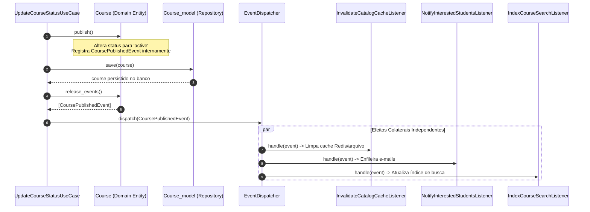
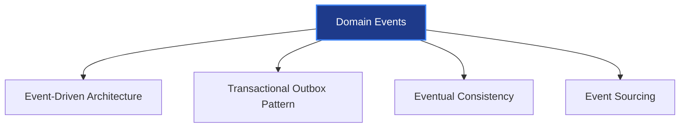

# Domain Events (Eventos de Domínio) — Arquitetura, Prática e Guia de Estudos

Este documento apresenta um estudo completo sobre **Domain Events (Eventos de Domínio)** dentro do Domain-Driven Design (DDD), comparando com os Observers técnicos de banco, demonstrando exemplos reais com entidades do nosso projeto (`io.edu`), mapeando onde o sistema já deveria estar utilizando esse padrão e indicando a bibliografia seminal para aprofundamento.

---

## 1. O que é um Domain Event?

Segundo **Eric Evans** e **Vaughn Vernon**, um **Domain Event** é:

> *"Um registro de algo significativo que aconteceu no passado dentro do domínio de negócio."*

### A Regra Gramatical de Ouro
Eventos de domínio representam fatos consumados que **já aconteceram**. Por isso, seu nome é **sempre expresso em linguagem ubíqua no pretérito perfeito**:
- ✅ `CoursePublished` (Curso Publicado)
- ✅ `UserRegistered` (Usuário Cadastrado)
- ✅ `PasswordResetRequested` (Redefinição de Senha Solicitada)
- ✅ `PaymentApproved` (Pagamento Aprovado)
- ❌ `PublishCourse` (Isso é um Comando / Use Case, não um evento)
- ❌ `CourseDataUpdated` (Isso é genérico/técnico, não expressa negócio)

### Imutabilidade Total
Um evento de domínio é um **Value Object imutável**. Uma vez ocorrido, o passado não pode ser reescrito. Ele contém apenas:
1. O momento exato em que ocorreu (`occurred_on`: `DateTimeImmutable`).
2. Os dados de contexto daquele momento (IDs, títulos, valores no instante do fato).

---

## 2. A Diferença Fundamental: Domain Event vs. Model Observer

Esta é a distinção mais importante para não misturar responsabilidades no código:

```
┌────────────────────────────────────────────────────────────────────────┐
│              COMPARAÇÃO: DOMAIN EVENT vs. MODEL OBSERVER               │
├───────────────────────────────────┬────────────────────────────────────┤
│   Domain Event (Negócio)          │   Model Observer (Técnico / SQL)   │
├───────────────────────────────────┼────────────────────────────────────┤
│ Camada: application/domain/       │ Camada: application/infrastructure/│
│                                   │                                    │
│ Disparado por: Entidades ou       │ Disparado por: MY_Model ao rodar   │
│ Use Cases.                        │ queries de INSERT / UPDATE.        │
│                                   │                                    │
│ Linguagem: Ubíqua de negócio      │ Linguagem: Técnica de banco relac. │
│ (ex: CoursePublishedEvent).       │ (ex: 'update' na tabela 'courses').│
│                                   │                                    │
│ Conteúdo: Entidades, IDs e VOs    │ Conteúdo: Arrays de colunas SQL,   │
│ ricos de negócio.                 │ diffs {'price': 100 -> 150}.       │
│                                   │                                    │
│ Propósito: Orquestrar regras e    │ Propósito: Auditoria técnica,      │
│ efeitos colaterais de negócio.    │ métricas de banco, replicação SQL. │
└───────────────────────────────────┴────────────────────────────────────┘
```

- **Model Observer** (o que fizemos no `MY_Model` com `AuditLogObserver`): É um gancho técnico de infraestrutura. Ele apenas audita que o banco de dados sofreu uma mutação física.
- **Domain Event**: É a expressão viva de que uma regra de negócio aconteceu.

---

## 3. Exemplo Real com o Nosso Projeto: Publicação de Curso

Vamos pegar a entidade real do nosso projeto: [`Course.php`](file:///home/thinkr/career/io.edu/application/domain/course/Course.php).

### O Cenário de Negócio
Quando um instrutor clica em **"Publicar Curso"**, o método `publish()` do curso é chamado:
```php
$course->publish(); // Status muda de 'draft' para 'active'
```

Hoje, se precisarmos:
1. Limpar o cache do catálogo público da vitrine de cursos.
2. Disparar e-mail para alunos interessados naquela categoria.
3. Indexar o curso no mecanismo de busca (ElasticSearch/Algolia).
4. Gravar log de negócio: *"O curso X foi disponibilizado ao público"*.

Sem Domain Events, o Use Case vira uma "árvore de natal" cheia de injeções (`CacheService`, `EmailService`, `SearchService`, etc.), violando o princípio SRP (*Single Responsibility*) e OCP (*Open/Closed*).

Com Domain Events, veja como a arquitetura se desenha:



---

### Implementação Passo a Passo do Exemplo

#### 1. A Interface Base do Evento de Domínio
Local: `application/domain/events/DomainEventInterface.php`

```php
namespace app\domain\events;

use DateTimeImmutable;

interface DomainEventInterface
{
	/**
	 * Data e hora exatas em que o evento ocorreu.
	 */
	public function occurred_on(): DateTimeImmutable;
}
```

#### 2. O Evento de Negócio Concreto
Local: `application/domain/course/events/CoursePublishedEvent.php`

```php
namespace app\domain\course\events;

use app\domain\events\DomainEventInterface;
use DateTimeImmutable;

final class CoursePublishedEvent implements DomainEventInterface
{
	private DateTimeImmutable $occurred_on;

	public function __construct(
		public readonly int $course_id,
		public readonly string $course_title,
		public readonly string $course_slug,
		public readonly int $category_id
	) {
		$this->occurred_on = new DateTimeImmutable();
	}

	public function occurred_on(): DateTimeImmutable
	{
		return $this->occurred_on;
	}
}
```

#### 3. A Entidade Gravando o Evento (Padrão Vernon / Fowler)
Dentro de [`Course.php`](file:///home/thinkr/career/io.edu/application/domain/course/Course.php):

```php
final class Course
{
	/** @var array<DomainEventInterface> */
	private array $recorded_events = [];

	public function publish(): void
	{
		if ($this->status->equals(CourseStatus::DRAFT)) {
			$this->status = new CourseStatus(CourseStatus::ACTIVE);

			// A própria entidade registra o fato histórico!
			$this->record_event(new CoursePublishedEvent(
				$this->id,
				$this->title,
				(string) $this->slug,
				$this->category_id
			));
		}
	}

	protected function record_event(DomainEventInterface $event): void
	{
		$this->recorded_events[] = $event;
	}

	/**
	 * Libera e limpa os eventos registrados para despacho.
	 *
	 * @return array<DomainEventInterface>
	 */
	public function release_events(): array
	{
		$events = $this->recorded_events;
		$this->recorded_events = [];
		return $events;
	}
}
```

#### 4. O Use Case Despachando Após a Persistência
No Use Case, a execução é limpa e coesa:

```php
public function execute(int $course_id): Course
{
	$course = $this->course_repository->find_by_id($course_id);
	if ($course === null) {
		throw new NotFoundException("Course not found");
	}

	// 1. Aplica regra de domínio
	$course->publish();

	// 2. Persiste o agregado no banco
	$saved_course = $this->course_repository->save($course);

	// 3. Despacha os eventos ocorridos
	foreach ($course->release_events() as $event) {
		$this->event_dispatcher->dispatch($event);
	}

	return $saved_course;
}
```

#### 5. Os Ouvintes (Listeners) Focados e Isolados
Cada ouvinte tem uma única responsabilidade:

```php
// Ouvinte 1: Limpeza de Cache de Vitrine
class InvalidateCatalogCacheListener
{
	public function handle(CoursePublishedEvent $event): void
	{
		$this->cache->delete('public_home_courses');
		$this->cache->delete('category_courses_' . $event->category_id);
	}
}

// Ouvinte 2: Notificação de Alunos
class NotifyInterestedStudentsListener
{
	public function handle(CoursePublishedEvent $event): void
	{
		$this->mailer->queue_notification(
			template: 'new_course_available',
			params: ['title' => $event->course_title, 'slug' => $event->course_slug]
		);
	}
}
```

---

## 4. Onde o Nosso Projeto Já Deveria Estar Usando Domain Events?

Ao analisar o código atual do `io.edu`, identificamos **4 pontos críticos** que se beneficiariam imensamente de Domain Events hoje:

| Ponto no Projeto | Evento de Domínio Sugerido | O que ele resolveria hoje? |
| :--- | :--- | :--- |
| **1. Publicação e Arquivamento de Cursos** <br>([Course.php](file:///home/thinkr/career/io.edu/application/domain/course/Course.php#L433)) | `CoursePublishedEvent`<br>`CourseArchivedEvent` | Invalidação do cache público de vitrine ([Courses.php](file:///home/thinkr/career/io.edu/application/controllers/Courses.php)) sem precisar acoplar o controller admin ao cache público. |
| **2. Criação Atômica de Curso + Produto** <br>([CreateCourseUseCase.php](file:///home/thinkr/career/io.edu/application/usecases/course/CreateCourseUseCase.php#L215)) | `CourseCreatedEvent` | Em vez do `CreateCourseUseCase` orquestrar a criação do produto comercial e preços tudo no mesmo método de 300 linhas, ele apenas salvaria o Curso e emitiria o evento. O Bounded Context Comercial escutaria e criaria o Produto 1:1. |
| **3. Cadastro de Usuário e Reset de Senha** <br>([CreateUserUseCase.php](file:///home/thinkr/career/io.edu/application/usecases/identity/CreateUserUseCase.php)) | `UserRegisteredEvent`<br>`PasswordResetRequestedEvent` | Desacoplaria o envio de e-mail de boas-vindas e tokens da persistência do usuário. O Use Case apenas salva; o listener envia o e-mail (síncrono ou via fila). |
| **4. Alteração de Configuração de Pagamento** <br>([UpdatePaymentConfigurationUseCase.php](file:///home/thinkr/career/io.edu/application/usecases/finance/UpdatePaymentConfigurationUseCase.php)) | `PaymentConfigurationUpdatedEvent` | Auditoria de segurança de credenciais criptografadas e notificação aos administradores caso um gateway de pagamento seja inativado. |

---

## 5. Arquiteturas e Padrões Relacionados

Ao estudar Domain Events, você se deparará com estes padrões fundamentais:



### 1. Event-Driven Architecture (EDA)
Arquitetura onde os fluxos de trabalho do sistema são disparados por acontecimentos (eventos). Permite que subsistemas sejam adicionados sem modificar o código que origina o evento.

### 2. Transactional Outbox Pattern
Em sistemas distribuídos ou com filas (RabbitMQ, SQS): e se o banco gravar o curso, mas o servidor de e-mail/fila cair antes de despachar o evento?
- **Solução Outbox:** O evento é salvo em uma tabela `domain_events_outbox` **dentro da mesma transação SQL** do curso. Um worker em segundo plano lê essa tabela e despacha para a fila com garantia de entrega (*At-least-once delivery*).

### 3. Consistência Eventual (Eventual Consistency)
Diferente da consistência imediata (onde tudo precisa estar no banco no mesmo milissegundo sob a mesma transação ACID), a consistência eventual aceita que o curso seja publicado agora e o e-mail ou o cache seja atualizado 2 segundos depois.

### 4. Observer vs. Mediator vs. Pub/Sub
- **Observer (GoF):** Acoplamento 1:N em memória direta dentro do mesmo processo.
- **Mediator:** Um objeto intermediário central coordena a interação entre múltiplos colegas.
- **Pub/Sub:** Totalmente desacoplado através de um barramento/canal (EventBus), onde produtores e consumidores não se conhecem.

---

## 6. Bibliografia e Roteiro de Estudos

Para dominar este assunto com profundidade teórica e prática, os seguintes materiais são leitura obrigatória:

### 1. Livros Fundamentais

1. **"Implementing Domain-Driven Design" (O "Livro Vermelho") — Vaughn Vernon**
   - **Capítulo 8: "Domain Events"**
   - *Por que ler:* É a explicação mais didática, completa e prática já escrita sobre como modelar, registrar e despachar eventos de domínio em linguagens orientadas a objetos (com exemplos diretos em código).
2. **"Domain-Driven Design: Tackling Complexity in the Heart of Software" (O "Livro Azul") — Eric Evans**
   - *Por que ler:* O livro que fundou o DDD. Explica a filosofia dos modelos ricos e da linguagem ubíqua.
3. **"Patterns of Enterprise Application Architecture (PoEAA)" — Martin Fowler**
   - *Por que ler:* O catálogo essencial de padrões corporativos (Unit of Work, Repository, Data Mapper).

### 2. Artigos Canônicos Gratuitos (Martin Fowler)

- 📄 **[Domain Event](https://martinfowler.com/eaaDev/DomainEvent.html)** — A definição original do padrão de evento em memória.
- 📄 **[What do you mean by “Event-Driven”?](https://martinfowler.com/articles/201701-event-driven.html)** — Fowler desconstrói os mitos de arquitetura orientada a eventos, explicando Event Notification, Event-Carried State Transfer e Event Sourcing.

### 3. Padrão PHP Oficial
- 📄 **PSR-14 (Event Dispatcher)**: Especificação padrão do PHP-FIG adotada pelo Symfony e Laravel para interfaces de despacho de eventos (`EventDispatcherInterface`, `ListenerProviderInterface`, `StoppableEventInterface`).
