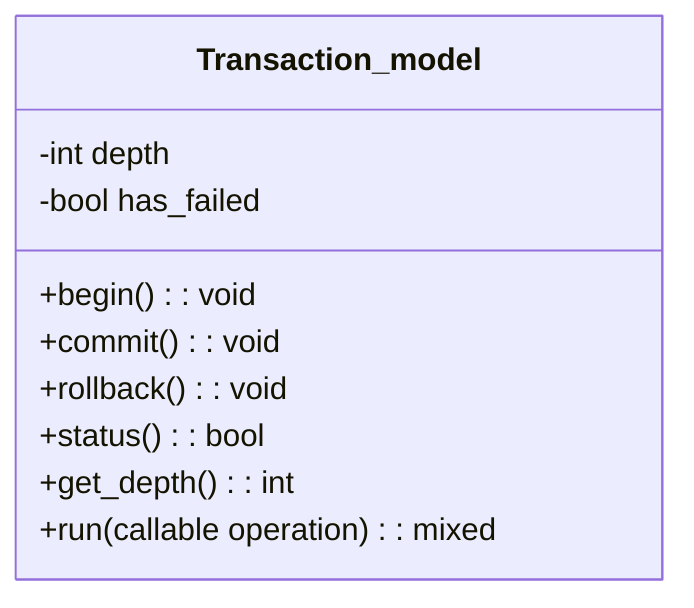
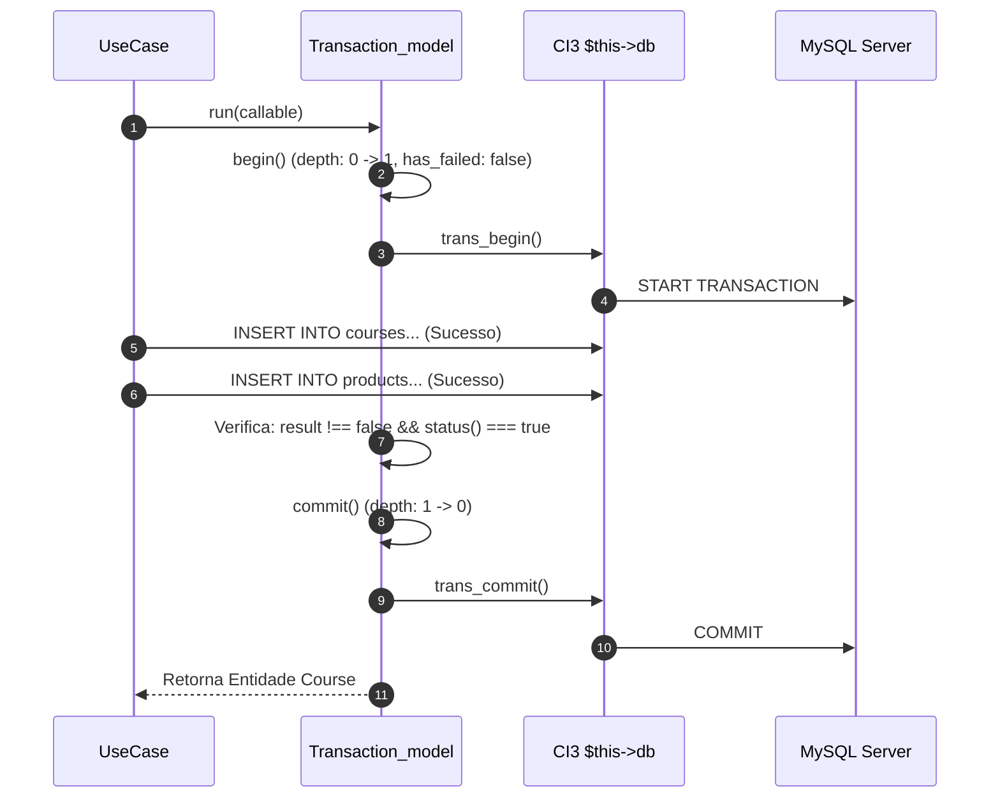
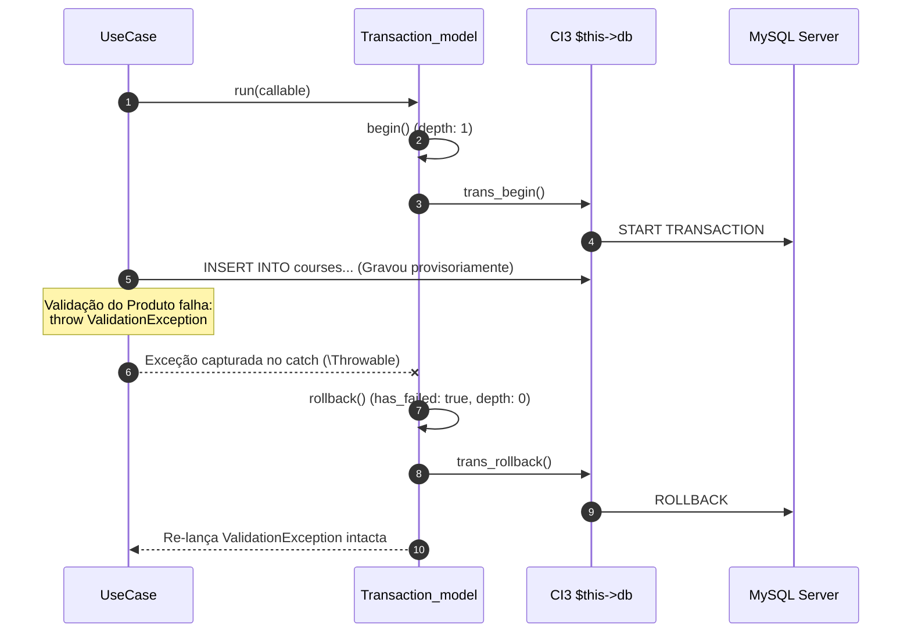
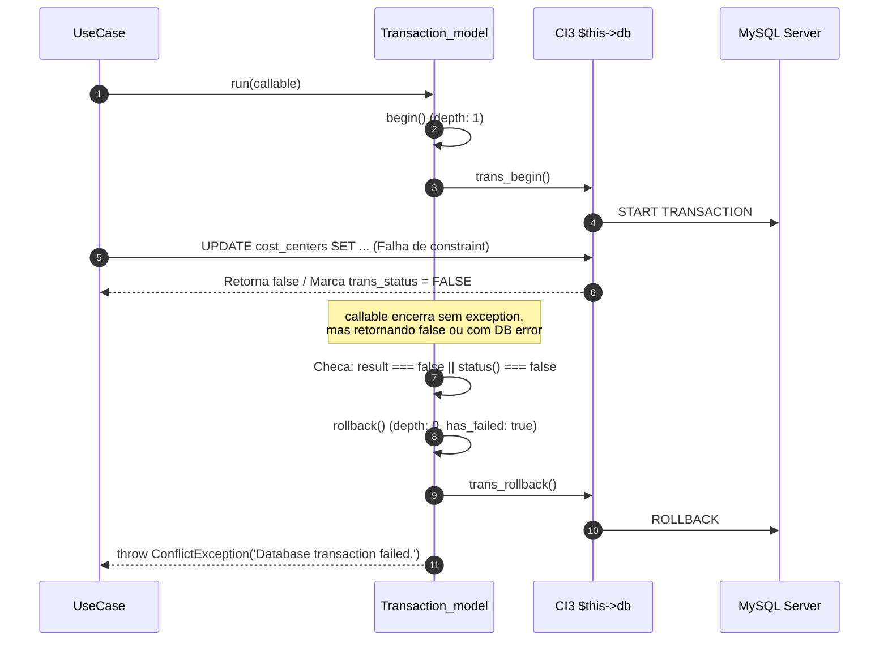
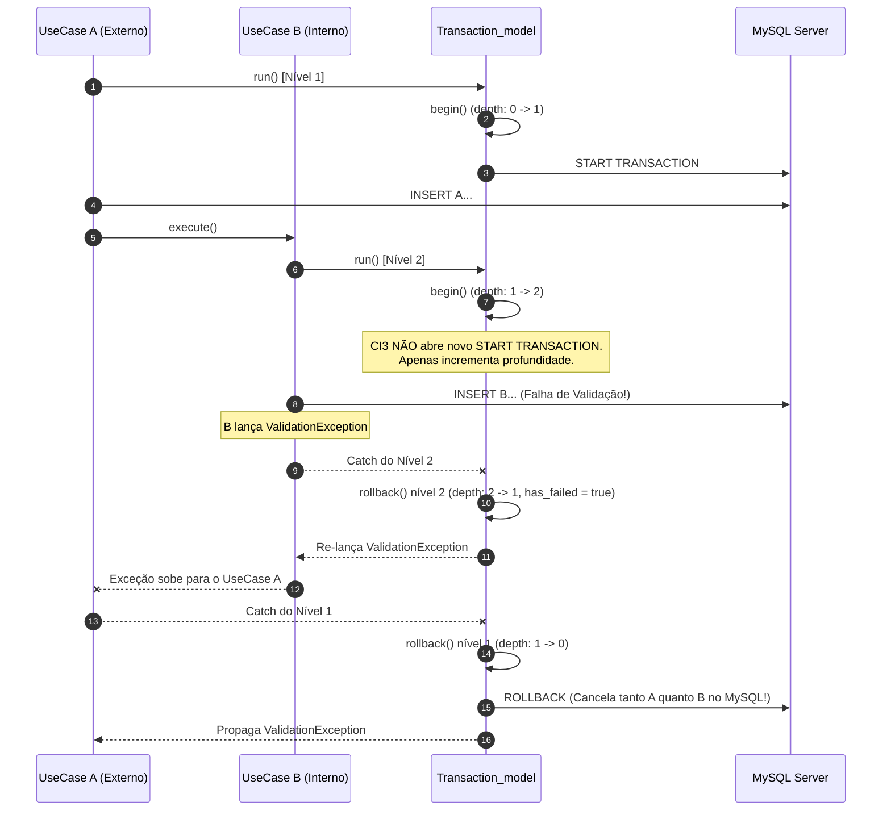
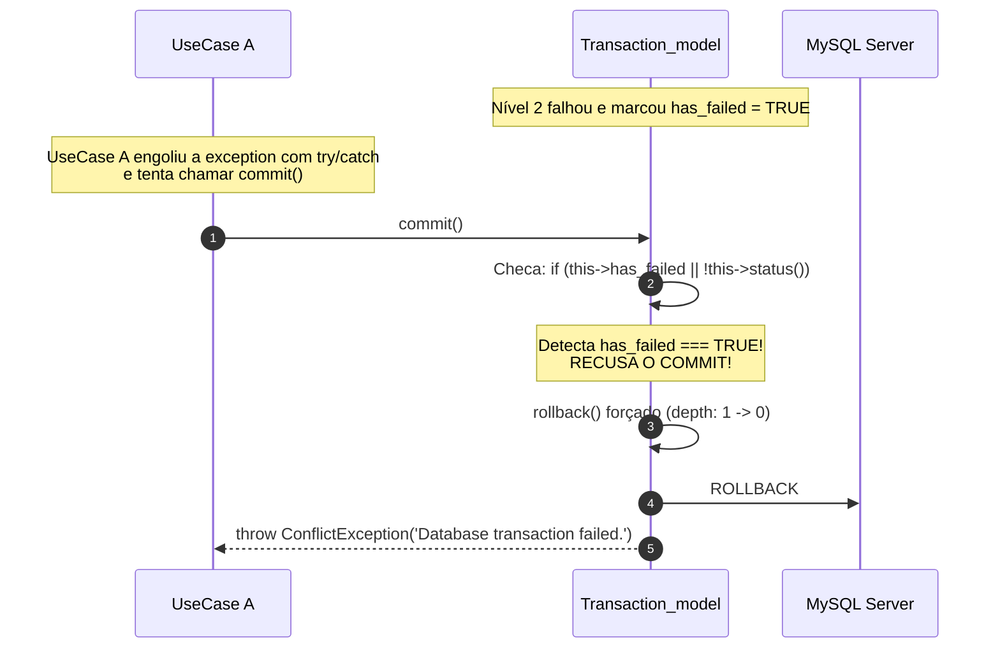

# Transaction Runner & Transactional Boundary — Deep Dive

Este documento detalha o funcionamento interno, as decisões arquiteturais e o comportamento por debaixo dos panos do [`Transaction_model.php`](file:///home/thinkr/career/io.edu/application/models/Transaction_model.php), implementado sob o contrato da [`TransactionInterface.php`](file:///home/thinkr/career/io.edu/application/infrastructure/database/TransactionInterface.php).

---

## 1. O Problema Resolvido e o Propósito Arquitetural

No CodeIgniter 3 nativo, o controle de transações pelo Query Builder (`$this->db->trans_begin()`, `$this->db->trans_commit()`, `$this->db->trans_rollback()`) é **procedural e manual**. Isso gera três grandes problemas em arquiteturas DDD:

1. **Vazamento de Infraestrutura:** Se um Use Case chamar `$this->db` diretamente, ele quebra o isolamento de camadas do DDD e fica impossível de ser testado com testes unitários puros sem mockar o driver SQL inteiro.
2. **Falhas sem Exceção:** No CodeIgniter 3, uma query com erro de sintaxe, violação de constraint ou falha de disco nem sempre lança uma `\Exception`. Frequentemente, o driver apenas define `$this->db->trans_status() = FALSE` ou o método de persistência retorna `false`. Se o desenvolvedor esquecer de checar isso, dados parciais ou corrompidos podem ser comitados.
3. **Transações Aninhadas Vulneráveis:** Quando um Use Case transacional chama outro método ou serviço que também abre transação, o CI3 apenas incrementa um contador interno (`_trans_depth`). Se o nível interno falhar e chamar `trans_rollback()`, o CI3 apenas decrementa a profundidade e **não impede** que o nível externo chame `trans_commit()` logo em seguida, a menos que haja um controle explícito de estado de falha.

O **Transaction Runner** resolve todos esses problemas centralizando a garantia atômica dentro de um bloco executável (`run(callable $operation)`).

---

## 2. Anatomia Interna do `Transaction_model`

O modelo é composto por métodos de controle e duas variáveis privadas que funcionam como uma máquina de estados:



### O Papel de Cada Variável Privada

| Propriedade | Tipo | Propósito Exato |
| :--- | :--- | :--- |
| `private int $depth` | `int` | **Rastreia o nível de aninhamento da transação.** <br>Inicia em `0`. Quando o primeiro `begin()` é chamado, vai para `1` (nível mais externo / transação real no MySQL). Se um segundo `begin()` for chamado antes do término do primeiro, vai para `2` (transação virtual aninhada). Só quando o contador retorna a `0` é que a transação no MySQL é fisicamente finalizada. |
| `private bool $has_failed` | `bool` | **Flag sentinela de falha irreversível.** <br>Inicia como `false`. Se **qualquer** nível (seja o mais interno ou o mais externo) sofrer uma exceção, retornar `false` ou chamar `rollback()`, essa flag é imediatamente cravada como `true`. Uma vez `true`, **nenhum commit subsequente será permitido**. Se algum nível externo tentar chamar `commit()`, o Runner detecta a sentinela, cancela o commit, força o rollback e lança uma exceção. |

---

## 3. Conexão Única Compartilhada (`$this->db`)

Uma dúvida muito frequente em transações é: *"O Transaction_model e os Repositórios/Models estão usando a mesma conexão MySQL?"*

**Sim, 100% garantido pela arquitetura do CodeIgniter 3:**
- `Transaction_model` estende `CI_Model`.
- Todos os repositórios (`Cost_center_model`, `Course_model`, `Product_model`) estendem `MY_Model`, que estende `CI_Model`.
- No CI3, o método mágico `CI_Model::__get('db')` faz:
  ```php
  return get_instance()->db;
  ```
- O `get_instance()->db` é uma instância **singleton** instanciada uma única vez no bootstrap da requisição.
- Portanto, quando o `Transaction_model` chama `$this->db->trans_begin()`, ele está abrindo a transação **na exata mesma conexão PDO/mysqli** onde o `Course_model` e o `Product_model` executarão seus `INSERT` e `UPDATE`.

---

## 4. O Fluxo de Execução do Método `run(callable $operation)`

Veja o algoritmo do método `run`:

```php
public function run(callable $operation): mixed
{
    $this->begin();

    try {
        $result = $operation();

        // 1. Verificação de falhas sem exceção (retorno false ou erro interno no DB)
        if ($result === false || $this->status() === false) {
            $this->rollback();
            throw new ConflictException('Database transaction failed.');
        }

        $this->commit();

        return $result;
    } catch (\Throwable $throwable) {
        // 2. Qualquer exceção PHP/Domain força o rollback imediato
        $this->rollback();

        if ($throwable instanceof AppException) {
            throw $throwable;
        }

        throw new ConflictException('Database transaction failed.', [], $throwable);
    }
}
```

---

## 5. Simulações Passo a Passo por Debaixo dos Panos

Abaixo estão 5 simulações detalhadas mostrando o que acontece a cada linha de código, o valor de cada variável e o comando SQL correspondente.

---

### Simulação 1: Execução Simples com Sucesso

**Cenário:** O Use Case cadastra um Curso e em seguida seu Produto Comercial. Ambos gravam com sucesso.



1. `TM::run()` chama `begin()`:
   - `$depth` era `0`, agora é `1`.
   - `$has_failed` é resetado para `false`.
   - `$this->db->trans_begin()` envia `START TRANSACTION` ao MySQL.
2. A closure é executada:
   - Salva o curso (`INSERT INTO courses...`).
   - Salva o produto comercial (`INSERT INTO products...`).
3. O callable finaliza e retorna a entidade `$course`:
   - `$result` não é `false`.
   - `$this->status()` retorna `true` (nenhum erro de SQL, `has_failed` é `false`).
4. `commit()` é acionado:
   - `$depth` decrementa de `1` para `0`.
   - `$this->db->trans_commit()` envia `COMMIT` ao MySQL.
5. Dados gravados no banco permanentemente.

---

### Simulação 2: Falha por Exceção de Domínio / Validação

**Cenário:** O Curso é gravado no banco, mas a validação de preço do Produto lança uma `ValidationException("Price cannot be negative")`.



1. `begin()` inicia transação no MySQL (`$depth = 1`).
2. Curso é inserido no MySQL provisoriamente.
3. Código tenta criar o produto, mas o preço é inválido: `throw new ValidationException(...)`.
4. O bloco `catch (\Throwable $throwable)` do Runner intercepta a exceção:
   - Invoca `$this->rollback()`.
   - `$has_failed` se torna `true`.
   - `$depth` decrementa para `0`.
   - `$this->db->trans_rollback()` envia `ROLLBACK` ao MySQL.
   - O MySQL desfaz o `INSERT INTO courses`. Nenhum registro órfão sobrevive no banco!
5. Como `$throwable` é instância de `AppException` (`ValidationException`), o Runner **re-lança a mesma exceção intacta**.
6. O controller e o interceptor global (`MY_Controller::_remap()`) capturam a `ValidationException` e mostram o alerta em português para o usuário.

---

### Simulação 3: Falha sem Exceção (Retorno `false` ou Erro Silencioso de SQL)

**Cenário:** Uma query falha no banco (ex: chave estrangeira inexistente ou constraint violada), o CI3 não lança exceção em tempo de execução, mas seta erro interno no driver.



1. `begin()` inicia transação (`$depth = 1`).
2. Operação é executada, mas o repositório falha e retorna `false`.
3. O callable finaliza normalmente (sem `throw`).
4. O `run()` inspeciona o retorno:
   ```php
   if ($result === false || $this->status() === false)
   ```
5. A condição é verdadeira!
6. O Runner invoca `$this->rollback()`:
   - Envia `ROLLBACK` ao MySQL.
7. O Runner lança:
   ```php
   throw new ConflictException('Database transaction failed.');
   ```
8. A falha silenciosa foi detectada, o banco foi protegido e o sistema transformou um erro silencioso em uma exceção semântica rastreável!

---

### Simulação 4: Transações Aninhadas — Quando a Transação Interna Falha

**Cenário:** O Caso de Uso Principal (A) abre uma transação. Durante sua execução, ele chama um Serviço/Caso de Uso Secundário (B) que também possui seu próprio `run()`. O serviço B falha.



1. **Entrada no Nível 1:**
   - `$depth` vai de `0` para `1`.
   - MySQL executa `START TRANSACTION`.
   - Ação do UseCase A é executada no banco.
2. **Entrada no Nível 2:**
   - UseCase B chama `run()`.
   - `$depth` vai de `1` para `2`.
   - O CI3 reconhece que já existe transação ativa e **não** envia um segundo `START TRANSACTION` (evita commit implícito do MySQL).
3. **Falha no Nível 2:**
   - Operação de B lança uma exceção.
   - O bloco `catch` do Nível 2 intercepta:
     - Chama `rollback()`: `$depth` decrementa de `2` para `1`.
     - **Importante:** A flag `$has_failed` é marcada como `TRUE`.
     - Re-lança a exceção.
4. **Propagação para o Nível 1:**
   - A exceção atinge o `catch` do Nível 1.
   - O Nível 1 chama `rollback()`:
     - `$depth` decrementa de `1` para `0`.
     - Como a profundidade chegou a `0`, o CI3 executa `ROLLBACK` no MySQL.
     - **Tudo é desfeito no banco:** tanto o INSERT de A quanto o INSERT de B!

---

### Simulação 5: Transações Aninhadas — E se o Chamador Externo Engolir o Erro Interno?

**Cenário:** O serviço interno (B) falha e executa rollback, mas o desenvolvedor do UseCase externo (A) colocou um `try/catch` manual engolindo o erro e tentou chamar `commit()` como se nada tivesse acontecido.



1. No Nível 2, a falha marcou `$has_failed = true`.
2. O UseCase A tenta chamar `commit()`.
3. O método `commit()` possui a guarda de integridade:
   ```php
   if ($this->has_failed || !$this->status()) {
       $this->rollback();
       throw new ConflictException('Database transaction failed.');
   }
   ```
4. O `Transaction_model` **recusa o commit**, força o rollback no MySQL e lança uma `ConflictException`.
5. **Resultado:** É matematicamente impossível comitar dados parciais quando qualquer parte da árvore transacional falhou.

---

## 6. Resumo das Garantias do `Transaction_model`

1. **Atomicidade Total:** Ou tudo é persistido ou absolutamente nada é persistido.
2. **Imunidade a Erros Silenciosos:** Falhas sem exceção (retorno `false` ou flag de erro do CI3) provocam rollback automático.
3. **Segurança em Aninhamento:** Transações internas que falham contaminam o estado geral com `$has_failed = true`, impedindo commits acidentais externos.
4. **Respeito ao DDD:** O Use Case depende exclusivamente da interface [`TransactionInterface`](file:///home/thinkr/career/io.edu/application/infrastructure/database/TransactionInterface.php), sem qualquer acoplamento a classes de banco ou drivers SQL do framework.
